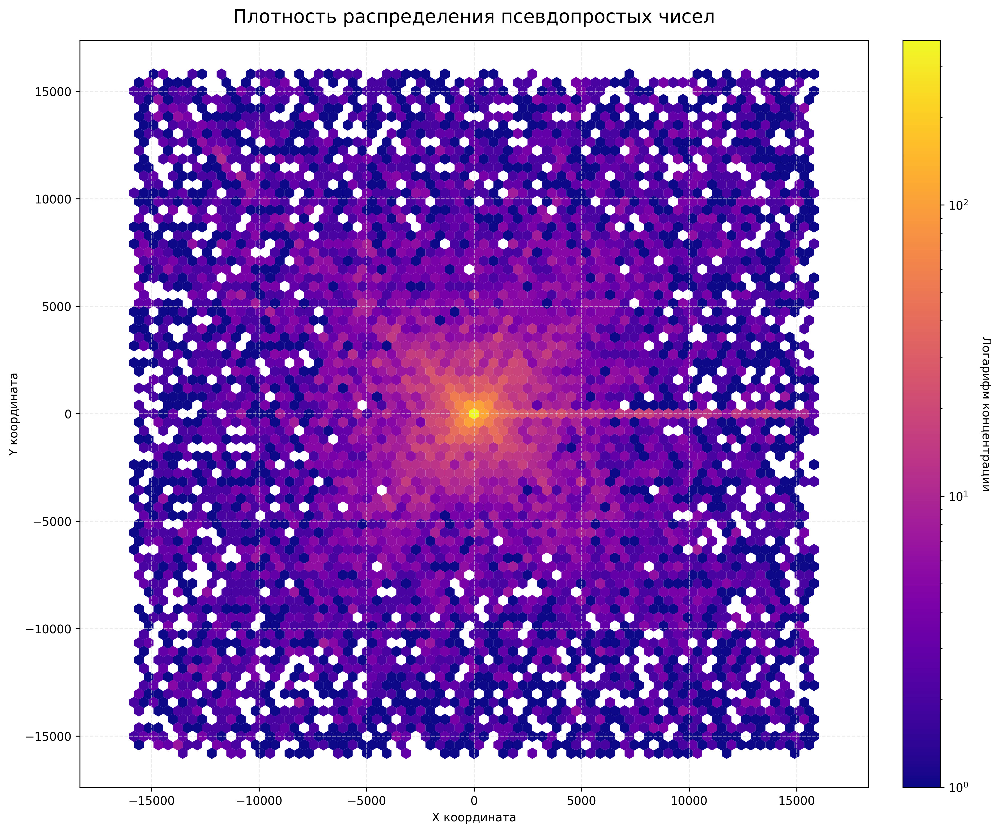
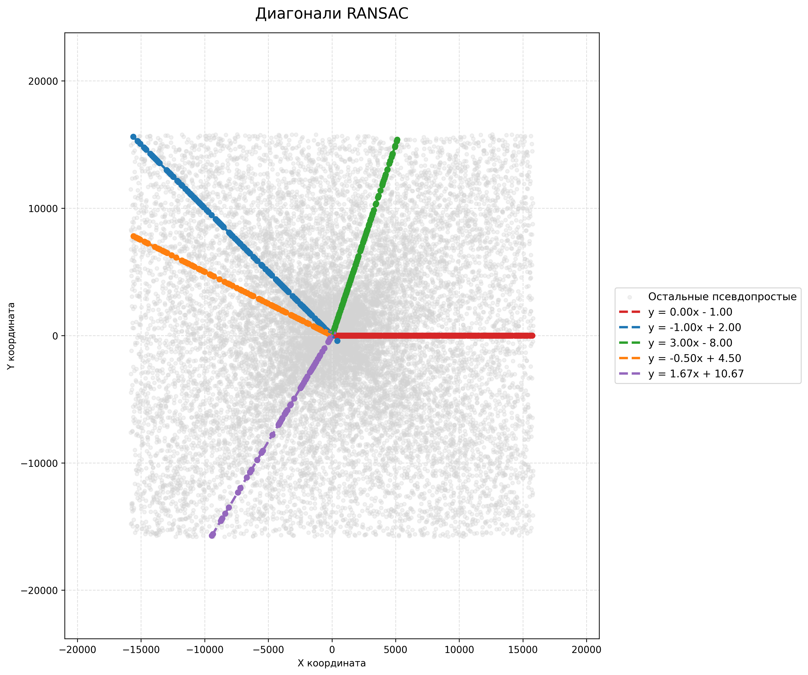
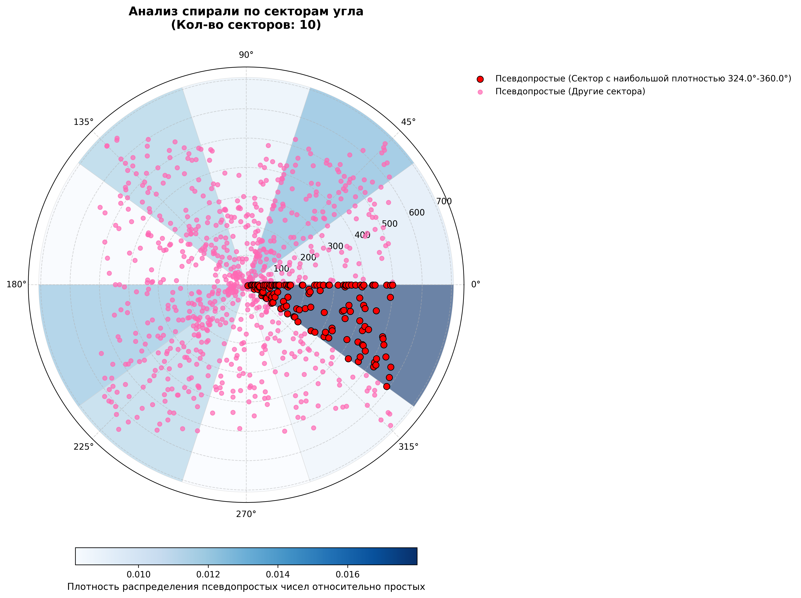

# Распределение псевдопростых чисел на скатерти Улама

## Описание проекта

Проект посвящен исследованию пространственного распределения **псевдопростых чисел** (чисел, которые проходят вероятностные тесты на простоту, но являются составными) на **скатерти Улама** — квадратной спирали, на которой простые числа демонстрируют склонность группироваться вдоль диагоналей.

Основной вопрос исследования: **проявляют ли псевдопростые числа аналогичную структурную упорядоченность**, или их распределение является полностью случайным?

Визуальную презентацию проекта можно посмотреть в [Project_Spiral_Ulam.pdf](Project_Spiral_Ulam.pdf)

---

## Основные выводы

- Псевдопростые числа **не распределены случайно** на скатерти Улама.
- Они **концентрируются вдоль диагоналей**, аналогично простым числам (подтверждено RANSAC и Монте-Карло).
- Их **плотность максимальна в центре** спирали и монотонно убывает к периферии.
- Обнаружены **статистически значимые угловые предпочтения** (отдельные секторы содержат аномально много псевдопростых чисел).
- Обнаруженные структуры **устойчивы к изменению масштаба** выборки и размера ячеек сетки.

## Основные графики
Некоторые графики, полученные по результатам работы.

Эти и остальные графики доступны в папке `charts/`. Процесс работы, в том числе их получения, описан в разделе ниже
### Плотность распределения псевдопростых чисел

### Диагонали концентрации псевдопростых чисел, найденные алгоритмом RANSAC

### Плотность псевдопростых чисел относительно простых по секторам

---

## Что было сделано?

В рамках проекта реализован полный цикл анализа данных — от генерации скатерти до статистической проверки гипотез и визуализации.

### 1. Генерация и подготовка данных
- Построена координатная сетка спирали Улама для чисел вплоть до **1 миллиарда**.
- Для каждого числа вычислены:
  - координаты `(x, y)` на плоскости
  - радиус `r` (расстояние от центра)
  - угол `angle_rad` (относительно положительной оси X)
- Для определения типа псевдопростых чисел были использованы открытые списки из [OEIS](https://oeis.org/) (например, [A001567](https://oeis.org/A001567), [A002997](https://oeis.org/A002997))

**Код:** `src/spiral_generator.py` строит координаты и обрабатывает числа; 
`src/nums.py` загружает списки псевдопростых; `src/update_nums.py` обновляет их.

### 2. Визуализация распределения
- Построены **графики рассеяния** (scatter plots) с цветовым кодированием: простые, псевдопростые и составные числа.
- Созданы **тепловые карты плотности (Hexbin)** для выявления зон скоплений.
- Визуализированы **радиальные кольца** и **угловые секторы** с отображением плотности псевдопростых чисел.

**Код:** `visualized_spiral.py` строит визуализации по готовым CSV; `src/hexbin_analysis.py` — карту плотности; `src/angle_analysis.py` — графики по секторам; `src/radius_billion.py` — радиальные кольца.

### 3. Угловой анализ
- Плоскость разбита на **угловые секторы**.
- Для каждого сектора рассчитано отношение числа псевдопростых к простым.
- Проведены статистические тесты:
  - **χ² (хи-квадрат)** — проверка неравномерности распределения по секторам
  - **Монте-Карло симуляция** — оценка значимости отклонений
  - **Тест Кейпера (Kuiper's test)** — проверка круговой равномерности

**Код:** `src/angle_analysis.py`

### 4. Радиальный анализ
- Плоскость разбита на **5 концентрических колец** до радиуса R = 15000.
- Для каждого кольца подсчитано абсолютное и относительное количество псевдопростых чисел.
- Проверена гипотеза о монотонном падении плотности при удалении от центра.

**Код:** `src/radius_billion.py`

### 5. Поиск диагональных структур (RANSAC)
- Применён алгоритм **робастной регрессии RANSAC** для обнаружения прямых линий, вдоль которых концентрируются псевдопростые числа.
- Для найденных прямых построены доверительные интервалы методом **бутстрапа**.
- Проведён **тест Монте-Карло** для оценки статистической значимости обнаруженных линий.

**Код:** `src/diagonals_analysis.py`

### 6. Анализ кластеризации (VMR / Hexbin)
- Координатная плоскость была разбита на шестиугольники.
- Рассчитан **индекс дисперсии (VMR)** для оценки степени кластеризации.
- Проведён **тест MAUP** (Modifiable Areal Unit Problem) — проверка устойчивости кластеров при изменении масштаба сетки.

**Код:** `src/hexbin_analysis.py`

### 7. Оптимизация алгоритмов детекции
- Реализован **комбинаторный перебор** ансамблей вероятностных тестов на простоту (через `itertools.combinations`).
- Построена **матрица ошибок** для каждого теста.
- Найдены **Парето-эффективные комбинации** тестов, обеспечивающие максимальную точность при минимальной вычислительной стоимости.

**Код:** `src/tests_effectiveness_analysis.py`

### 8. Статистическая проверка результатов
Все ключевые результаты проверены на устойчивость с помощью критерия χ² (Хи-квадрат), симуляций Монте-Карло, теста Кейпера, бутстрапа и MAUP-анализа.

**Код:** `src/angle_analysis.py` — угловые тесты; `src/diagonals_analysis.py` — проверка диагональных структур и бутстрап; `src/hexbin_analysis.py` — кластеризация и MAUP.

---

## Используемые технологии

| Библиотека / модуль | Назначение |
| --- | --- |
| `pandas` | Чтение и обработка табличных данных и CSV-файлов |
| `numpy` | Быстрые вычисления координат и тригонометрия |
| `matplotlib` | Построение и сохранение графиков |
| `seaborn` | Дополнительные средства визуализации |
| `scipy.stats` | Статистические тесты (χ², распределения) |
| `astropy` | Реализация теста Кейпера |
| `scikit-learn` | Регрессор RANSAC |
| `itertools` | Комбинаторный перебор тестов |
| `pydantic` | Валидация данных |
| `requests` | Получение данных из OEIS |
